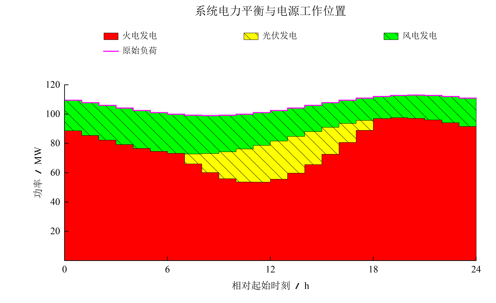

# GRIDMIND

GRIDMIND is a modular research prototype for generation planning and chronological power system operation. GRIDMIND 是模块化的电源规划与全年逐时运行研究原型。桌面入口位于 `gridmind_app/`，算法位于 `power_ga/`，两者通过 `project_main.execute()` 连接。

## Current capabilities / 当前能力

- Binary candidate-project encoding, initial population, selection, crossover, mutation, elitism and convergence records. / 候选项目二元编码、初代、选择、交叉、变异、精英保留及收敛记录。
- A deterministic 8,760-hour single-region operation model covering coal, gas, conventional hydro, pumped storage, battery storage, wind, solar PV and biomass. / 单区域全年8760小时确定性运行，覆盖八类机组。
- Storage charge, discharge and internal energy carry continuously across day and month boundaries. / 储能功率与内部库存跨日、跨月连续。
- One workbook for annual, monthly, daily, hourly, project, storage, GA and data-quality tables. Static figures are kept in separate figure folders; the desktop viewer supports day, week, month, year and arbitrary hour ranges. / 一份汇总工作簿，图表分开存档，交互窗口支持日周月年和任意小时区间。

The model is a transparent research baseline. It does not solve full network power flow, probabilistic reliability, hydraulic cascade scheduling or a globally optimal annual unit-commitment problem. 当前是透明可审计的研究基线，尚未提供完整潮流、概率可靠性、梯级水电或全年全局最优机组组合。

## Layout / 目录

```text
gridmind_app/            Desktop UI, icon and EXE build script / 窗口与打包
power_ga/data_collection/     Input mapping and validation / 数据接入
power_ga/initial_population/ Binary encoding / 初代编码
power_ga/operation_simulation/ Chronological simulation / 运行模拟
power_ga/fitness_and_convergence/ Evaluation / 适应度与收敛
power_ga/genetic_iteration/ GA and project evaluator / 遗传迭代
power_ga/result_output/ Reports, figures and viewer / 结果输出
input/                   Synthetic teaching input and editable cost assumptions
tests/                   Synthetic regression cases / 合成回归算例
examples/previews/       Synthetic display preview / 合成展示预览
docs/MATHEMATICS.md      Equations and scope / 数学公式与边界
```

## Run / 运行

```powershell
python -m pip install -r requirements.txt
python main.py --skip-figures            # Included synthetic teaching case / 合成教学算例
python gridmind_app/main.py --smoke-test  # Headless window initialization / 后台窗口校验
python gridmind_app/main.py               # Desktop application / 桌面窗口
python -m unittest discover -s tests -q
```

On Windows, `gridmind_app/build.ps1` uses PyInstaller to create `GRIDMIND.exe` with the original icon and bundled renderer. Static native Origin figures require a separately installed Origin; turn off the figure option in the desktop app when unavailable. The EXE also accepts `--batch-source <compatible-folder> --batch-year 2029 --batch-output <result-folder> --batch-simulate-only` for background verification. A compatible external project database is selected by the user and is never bundled with this repository. Windows 下可用打包脚本生成带原创图标与渲染脚本的 EXE；原生 Origin 静态图需要本机另行安装 Origin。外部项目数据库由用户选择，仓库不附带数据库。



## Data and licensing / 数据与许可

All included hourly profiles are synthetic. The editable technology-cost CSV contains benchmark-derived and explicitly assumed values; it is **not** a validated local project quote. No private regional or national project input, output table, result figure or project-specific metadata is distributed. 本仓库的逐时曲线仅为合成教学数据；成本表是可编辑试算参数，不能作为项目报价。私有项目数据及其结果不公开。

Code and original documentation are provided under the [MIT License](LICENSE). Optional dependencies retain their own licenses. / 代码与原创文档采用 MIT 许可证，第三方依赖遵循各自许可证。

For the verified development checkpoint, see [Stage report / 阶段成果](docs/PROGRESS_2026-10-13.md). / 当前已验证的开发状态、16项合成测试和适用边界见阶段报告。
