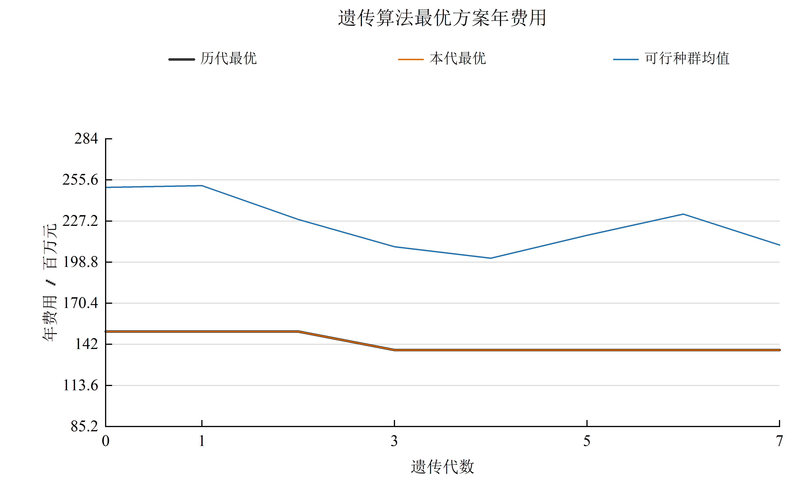
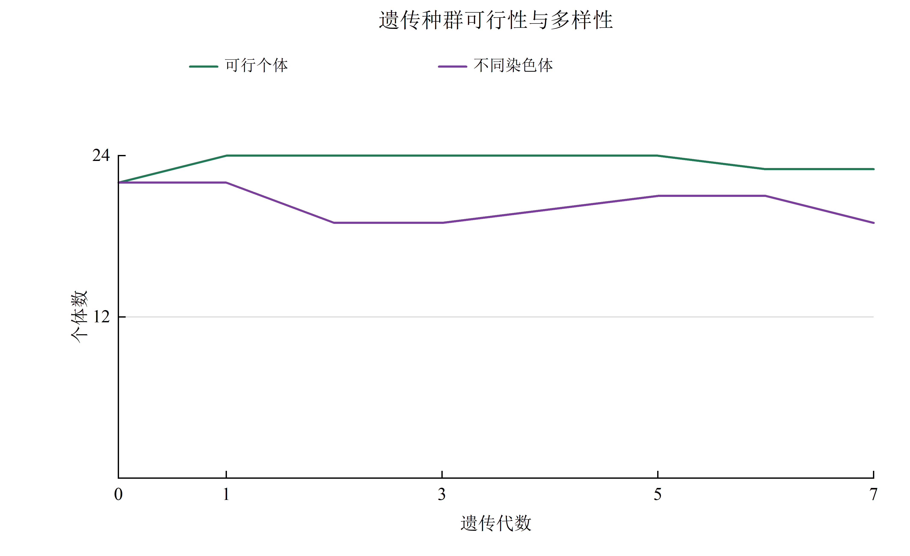
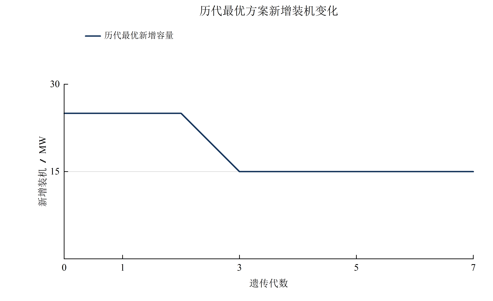
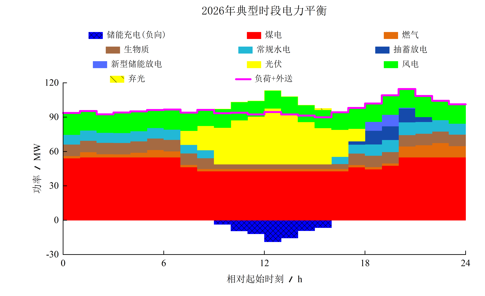
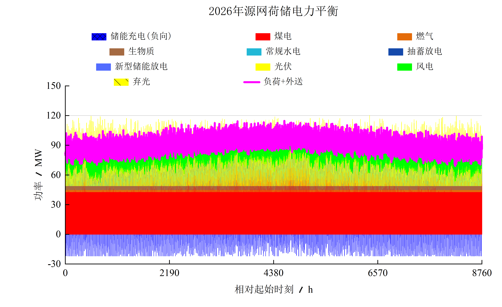
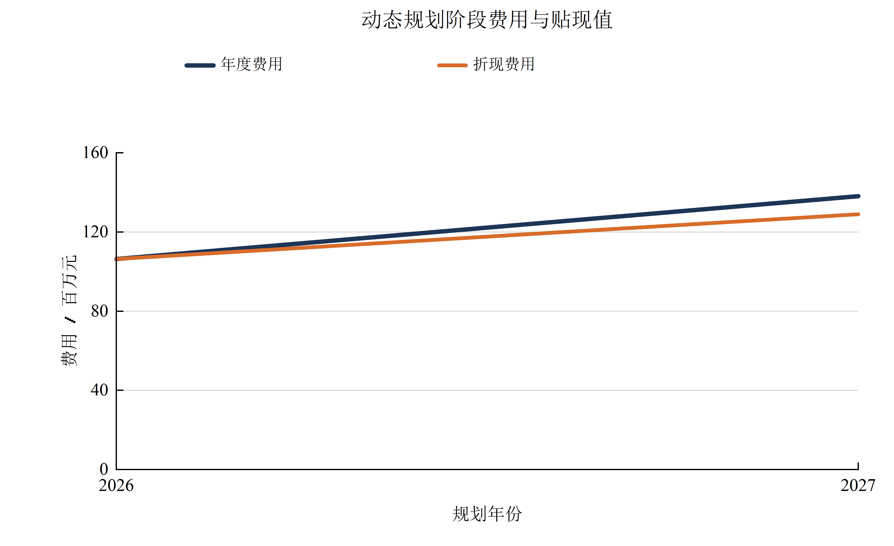
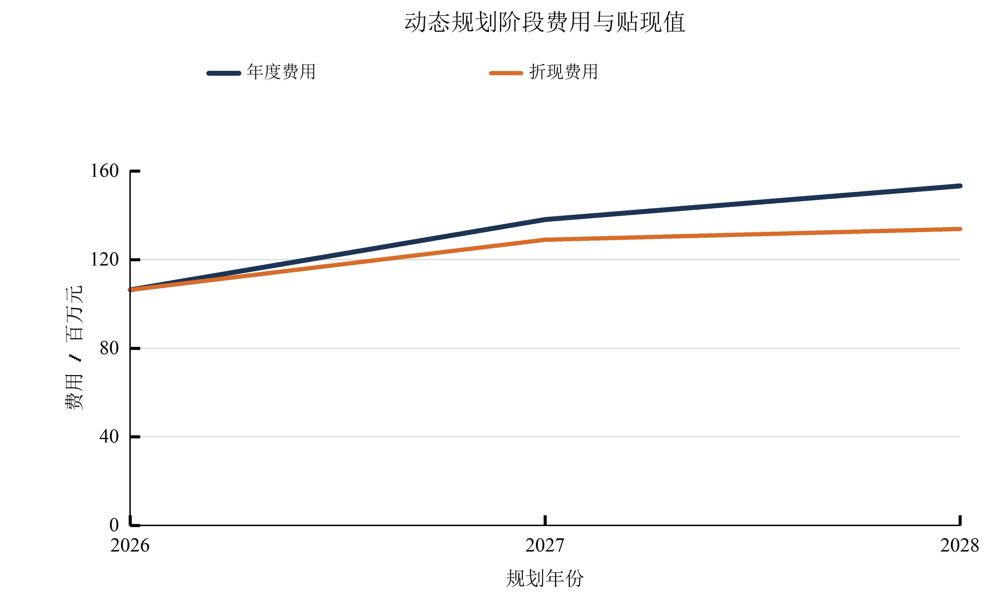
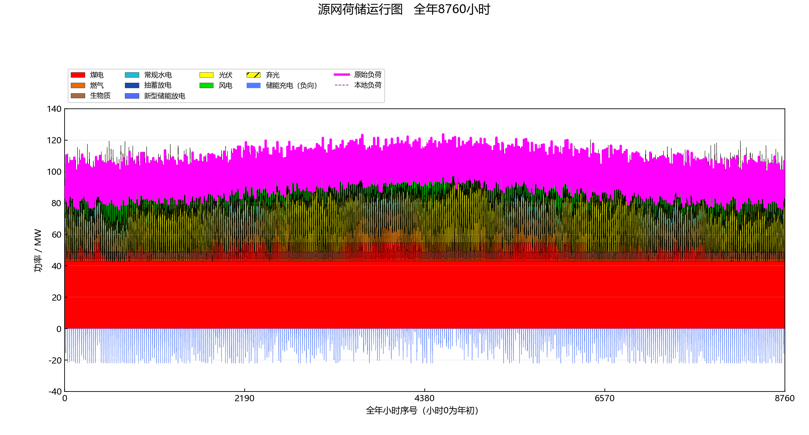

# 完整合成算例：遗传算法与动态规划 / Complete synthetic GA–DP case

本章的每一条负荷、风光曲线、容量和费用均由仓库内脚本或合成参数表生成。八类既有电站为煤电、燃气、常规水电、生物质、抽蓄、电池、风电和光伏；另有八个候选建设项目。任何数字都不来自外部项目库。All inputs are generated by the included seeded scripts and illustrative cost CSV; no external project database is used.

本章同时给出相同合成案例的**双年度**与**三年度** GA/DP 严格对照；三年度例子只改合成负荷倍率，真实逐年源库试算的项目数值仅留用户本机。The two controlled comparisons use synthetic inputs only. The desktop full-horizon option additionally reads separate annual source files, whose project-derived values are never published.

## 1. 遗传算法 / Genetic algorithm

单年度规划年有 8 位建设染色体 $`x\in\{0,1\}^8`$。对每个个体运行 8,760 小时，目标是年化建设费用与运行变动费用之和；全年缺供、过剩、在线备用不足以及规划容量缺口是硬约束。Gen=0、轮盘赌、单点交叉、位变异、精英保留和停滞终止的公式见[数学附录](MATHEMATICS_APPENDIX.md)。The single-year GA evaluates each chromosome through the same deterministic hourly engine used by the application.

固定随机种子 19、种群 24、最大 20 代时，GA 在第 3 代找到仅增加 15 MW 燃气项目的最优染色体 `01000000`。最佳年费 **138,077,847.65 元**；全年缺供与在线备用不足均为 0；最大逐时功率平衡残差 **2.84×10⁻¹⁴ MW**。脚本另外穷举了全部 $`2^8=256`$ 个方案，其中 240 个可行，最优费用与染色体完全相同。The exhaustive check establishes optimality for this finite eight-bit example; it does not prove GA optimality in general.











完整的[单年度汇总工作簿](../examples/results/v0.2.0/ga_annual_summary.xlsx)含年度、项目、8760 小时、逐站储能、逐日、逐月和遗传迭代表。The workbook retains numerical values, while figures remain in separate folders.

## 2. 动态规划 / Dynamic programming

PPT 将规划年定义为阶段，已投运候选集合定义为状态，本年新建项目定义为决策，状态只能由未建转为已建。本案例用 2026、2027 两个**合成年份**：首年负荷为同一合成曲线的 0.82 倍，次年为原曲线；两年复用合成风光天气以隔离算法差异。贴现率 $`r=0.07`$。The two stages use identical candidate identities and operating logic, with only the declared load scaling changing. Desktop project runs additionally offer separate annual source curves by default; this published controlled case intentionally uses scaled synthetic demand.

记 $`s_t\subseteq J`$ 为阶段末累计投运集合，$`p\subseteq s_t`$ 为上一阶段状态，阶段年费 $`c_t(s_t)=C_t^{ann}(s_t)+C_t^{op}(s_t)`$。所有可行状态都运行完整 8,760 小时；不可行状态不进入路径。顺序递推为

$$
F_1(s)=c_1(s),\qquad
F_t(s)=\frac{c_t(s)}{(1+r)^{t-1}}+\min_{p\subseteq s}F_{t-1}(p).
$$

每年重新计入已投运项目的**年化**费用，故未把同一工程总投资重复支付；这是等年值口径的教学模型。The annualized cost is charged for every year in service, and stage 2 is discounted to the first planning year. The code does not infer a capital payment schedule from the synthetic annual-cost table.

Gurobi 再独立解一个 0/1 状态模型：每年恰选一个可行状态，任一候选的累计投运位不可从 1 回到 0，目标为上述折现阶段费用之和。Bellman 与 Gurobi 的最优费用一致，构成有限状态路径的交叉校验。[Gurobi Python API](https://docs.gurobi.com/projects/optimizer/en/current/reference/python/model.html) describes the binary variables, constraints and optimization calls used here.

Gurobi 优化的是预先经8760小时规则模拟计算的**阶段路径**，不把逐时运行规则替换成全年全局MILP。Gurobi selects among precomputed feasible annual states; the hourly dispatch itself remains the documented deterministic rule model.

| 合成年份 / Synthetic year | DP 累计状态 / State | 本年新建 / Added | 年费 / Annual cost (元) | 折现费用 / Discounted (元) |
|---|---:|---|---:|---:|
| 2026 | 0 | 无 / none | 106,363,865.87 | 106,363,865.87 |
| 2027 | 2 | 15 MW 燃气 / gas | 138,077,847.65 | 129,044,717.43 |

累计最优折现费用为 **235,408,583.30 元**。两年的最大逐时功率平衡残差分别为 $`1.60\times10^{-14}`$ 与 $`2.84\times10^{-14}`$ MW。The [two-year comparison workbook](../examples/results/v0.2.0/ga_dp_comparison.xlsx) includes all 512 stage-state evaluations, annual choices, costs and GA convergence.



[最终年完整8760小时与储能工作簿 / Final-year hourly and storage workbook](../examples/results/v0.2.0/dp_final_year_summary.xlsx) 由正式EXE的公开合成批处理入口生成。The archived DP final year uses the same selected gas project as the single-year GA case.

### 全规划年递推的合成反例 / Full-horizon recursion check

为单独核对新增的三阶段递推，测试中只设一个候选位，按年度给出状态0与状态1的阶段费：$`(1,10)`$、$`(12,3)`$、$`(12,3)`$，贴现率10%。合法状态只能0→1，Bellman与Gurobi均得到路径$`(0,1,1)`$，费用为$`1+3/1.1+3/1.1^2\approx6.2066`$。This small synthetic counterexample verifies the stage transition and discount formula; it is separate from the two-year eight-technology numerical comparison above. A second synthetic integration test runs 8,760 hours in each of three annual stages and checks stage-specific inputs, external commitments and hourly balance.

### 八类电源三年度完整案例 / Three-year eight-technology case

把上述**同一组合成八类电源、八个候选项目**延伸至2028年。2026、2027、2028年的负荷分别为固定种子基准8760小时曲线的0.82、1.00、1.08倍；各年风光曲线复用同一固定种子天气。该倍率只用于可复算的教学压力情景，**不是逐年源库或真实负荷预测**。The three-year example is a controlled synthetic stress test; weather reuse isolates the cost of different build timings.

| 合成年份 / Year | DP累计状态 / State | 本年新建 / Added | 年费 / Annual yuan | 折现费用 / Discounted yuan |
|---|---:|---|---:|---:|
| 2026 | 0 | 无 / none | 106,363,865.87 | 106,363,865.87 |
| 2027 | 2 | 15 MW燃气 / gas | 138,077,847.65 | 129,044,717.43 |
| 2028 | 2 | 无 / none | 153,276,394.00 | 133,877,538.65 |

按7%贴现，三年合计 **369,286,121.94 元**；Bellman与Gurobi目标逐分一致。DP运行了 $`3\times2^8=768`$ 个年度状态；GA在已计算的同一状态费用表上查询1,179个不同的逐年建设染色体，路径同为 `(0,2,2)`，总费用差小于一分。These counts represent different work: DP computes annual hourly states, whereas GA looks up the shared table. They do not establish a wall-clock speed ranking.

每个被选年度独立重跑8760小时：最大功率平衡残差 $`2.84\times10^{-14}`$ MW，最大储能状态残差 $`3.55\times10^{-15}`$ MWh，水电月预算超额0 MWh；三个年度的确定性缺供与在线备用不足均为0。2028年煤、气、水、生物质、抽蓄、电池、风、光八类均有正的实际供电或放电量。Independent replay, CSV/workbook parity and technology totals are stored in the [v0.2.5 verification record](../examples/results/v0.2.5/full_horizon_verification.json) and [physical table](../examples/results/v0.2.5/full_horizon_physical.csv).





当前0.2.5策略生成的[三年度GA/DP汇总工作簿](../examples/results/v0.2.5/full_horizon_comparison.xlsx)、[各年建设与费用](../examples/results/v0.2.5/full_horizon_stages.csv)、[八类电量](../examples/results/v0.2.5/full_horizon_technology.csv)、[末年8760小时与逐站储能工作簿](../examples/results/v0.2.5/full_horizon_final_year.xlsx)及[12张末年月图](FULL_HORIZON_GALLERY.md)分别归档；原0.2.4工作簿仍保存在对应版本目录以便核对。The current workbook records the balanced seed policy; the selected physical path and monthly figures are unchanged.

## 3. 同口径算法对比 / Like-for-like comparison

为了比较算法而非目标函数，另用 GA 搜索同一个双年度和三年度问题：染色体按年度编码建站，重复置 1 按最早建站年解释；阶段费用直接查询 DP 已算过的**同一张**状态费用表。Gen=0 加入每个候选在可选年度单独建设的基准方案，其余个体随机生成。Both methods therefore use the same 8,760-hour simulations, feasibility tests, discount rate and project set.

| 指标 / Metric | GA | DP + Gurobi |
|---|---:|---:|
| 最优阶段状态 / Best stage states | `(0,2)` | `(0,2)` |
| 折现总费用 / Discounted objective | 235,408,583.30 元 | 235,408,583.30 元 |
| 相对 DP 差距 / Relative gap | 0.00% | 0.00% |
| 搜索性质 / Search guarantee | 启发式，无一般最优保证 | 枚举状态后的 Bellman 最优，Gurobi 独立核验 |

三年度案例的同口径结果也是 **GA `(0,2,2)` / DP `(0,2,2)`，折现总费各为369,286,121.94元，差距在分位舍入后为0**。此结果由固定种子19、种群64、最多80代的这一次合成运行支持；不能推广为GA必然找到最优路径。The additional stage raises DP hourly evaluations from 512 to 768; GA objective queries remain cached table lookups, so the raw counts are not a fair runtime benchmark.

多年度 GA 采用种群 64、最大 80 代、随机种子 19；本算例的“末年只建燃气”方案已作为有物理意义的 Gen=0 种子加入，故最优费用在第 0 代即出现，随后因停滞在第 20 代停止。GA 共查询 1,017 个不同的逐年建设染色体；DP 实际执行 $`2\times2^8=512`$ 个年度状态的8760小时评价，GA随后只查询同一缓存表。因此这些计数衡量的工作不同，不能直接拿来宣称一种算法运行更快。The seeded optimum demonstrates objective consistency in this controlled case, not a generic convergence advantage.

本小算例的 0% 差距不意味着两种方法普遍等价：GA 受初代、种群和停止条件影响；DP 状态数随候选数按 $`2^{|J|}`$ 增长，阶段转移的朴素枚举约为 $`3^{|J|}`$。Both methods inherit the same deterministic single-region operation assumptions. In this release the DP path is capped at eight candidate bits in the desktop application to keep state enumeration reviewable.

### 有限搜索预算与随机种子 / Limited-budget seed sensitivity

为检查上述0%差距是否依赖初代和搜索预算，在**同一张**三年度768行8760小时阶段费用表上按4组预算、每组种子1–20各运行一次。0.2.4将单项目建设种子按“末年→首年”放入Gen=0，小种群截断时可能完全遗漏较早建设年；0.2.5改为各规划年交织，种子控制各年候选位序，任一截断前缀的年度种子数最多相差1。两个版本均保留全不建、全建、两位精英、交叉率0.85和逐位变异率0.045。The scenario costs, constraints, seeds and GA operators are identical; only the single-project seed ordering changes.

| 种群 / Population | 最多代数 / Max generations | 旧策略命中 / v0.2.4 hits | 均衡策略命中 / v0.2.5 hits | 旧平均差距 / Old mean gap | 新平均差距 / New mean gap |
|---:|---:|---:|---:|---:|---:|
| 8 | 4 | 1/20 | 8/20 | 42.12% | 30.93% |
| 10 | 6 | 1/20 | 8/20 | 36.35% | 15.01% |
| 12 | 12 | 20/20 | 10/20 | 0.00% | 6.90% |
| 64 | 80 | 20/20 | 20/20 | 0.00% | 0.00% |

旧策略的种群12恰好把本例最优的“次年只建燃气”直接放进Gen=0，导致20次都在初代达到最优；均衡策略不保证把该方案放进小种群，因此该档命中降为10/20。这揭示旧版0%结果的初代依赖，并非物理模型或费用发生变化。新版种群8与10的命中提高，但四档同时改变种群数和最多代数，不能分别归因，更不能推断一般最优概率。The v0.2.5 source and EXE record `balanced_by_stage_v2` in their planning archives so older results remain identifiable. Reproduce the earlier policy from immutable [v0.2.4 source commit](https://github.com/Entropyneverfade/GRIDMIND/commit/b544d3be3212f105b2f82125762b1b05307c94f4).

新版与旧版的完整年度状态费用表SHA-256均为 `107c28e075ee129a8716165f6c37b11560c67a304b04fcd8cb638d4038b66b23`；Bellman/Gurobi最优路径仍为 `(0,2,2)`，目标仍为369,286,121.94元。新版80条GA路径逐行从该表重算、全部满足建设单调性和阶段可行性；34个不同“年–状态”独立回放8760小时，最大功率平衡残差 $`2.84\times10^{-14}`$ MW、最大储能方程残差 $`3.55\times10^{-15}`$ MWh。见[新版逐种子CSV](../examples/results/v0.2.5/ga_sensitivity_seeds.csv)、[新版预算汇总](../examples/results/v0.2.5/ga_sensitivity_summary.csv)、[新版验收记录](../examples/results/v0.2.5/ga_sensitivity_audit.json)；[旧版逐种子CSV](../examples/results/v0.2.4/ga_sensitivity_seeds.csv)仍可复核。The 20-seed hit counts are observations for this fixed synthetic case, not a wall-clock speed ranking or an algorithm-wide guarantee.

## 4. 图、表与复现 / Figures, tables and reproduction

全年图保留 8,760 原始小时，但细节请查看 [12 张自然月图](MONTHLY_GALLERY.md)。每月标注该月有真实缺供时的最大缺供日；若无缺供而有备用不足，则标注最大备用不足日；两者均无时标注净负荷峰值日，另标出最大弃电日。No zero-shortage interval is mislabeled as a shortage event.

```powershell
python -m pip install -r requirements.txt
python -m pip install -r requirements-gurobi.txt  # 另需有效 Gurobi 许可
python -m examples.synthetic_full_case --output synthetic_ga --population 24 --generations 20 --seed 19 --origin-figures
python -m examples.verify_full_case --output synthetic_ga/exhaustive_audit.json
python -m examples.synthetic_dynamic_case --output synthetic_ga_dp --origin-figures
python -m examples.synthetic_dynamic_case --output synthetic_ga_dp_full --full-horizon --origin-figures
python -m examples.verify_dynamic_case --output synthetic_ga_dp_full
python -m examples.synthetic_ga_sensitivity --output synthetic_ga_sensitivity  # 0.2.5均衡初代
python -m examples.verify_ga_sensitivity --output synthetic_ga_sensitivity --reference-states synthetic_ga_dp_full/tables/all_stage_states.csv
# 也可直接验收仓库附带的合成结果，无需重跑768个年度状态
python -m examples.verify_ga_sensitivity --output examples/results/v0.2.4 --reference-states examples/results/v0.2.4/full_horizon_all_states.csv
python gridmind_app/main.py --export-monthly-views synthetic_ga_dp_full/final_year synthetic_ga_dp_full/figures/monthly_views
python gridmind_app/main.py --export-monthly-views synthetic_ga synthetic_months
```

上述静态 Origin 图需要本机安装 Origin；动态规划的数值表和 EXE 交互窗口不依赖 Origin。The supplied PNGs were rendered locally from the synthetic run; the editable source data and plotting scripts remain in the code modules. The current engine omits network flow, uncertainty based adequacy, reservoir cascade hydraulics and multi-year weather uncertainty.
