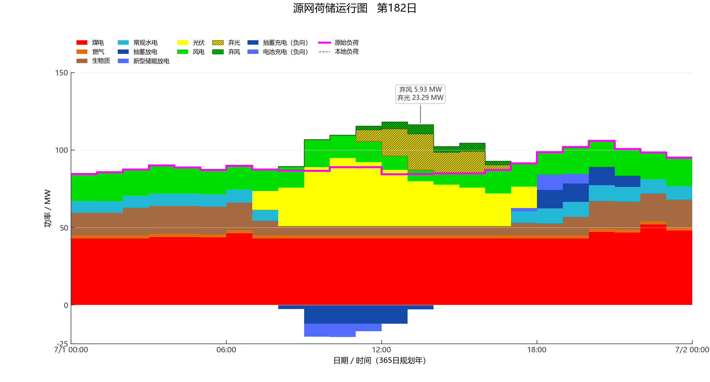

# GRIDMIND 项目报告

更新日期：2026-10-14。功能基线：公开版 **0.2.14**。本报告采用中文说明，数值均指向仓库内具体版本的合成算例；1.0 候选和 1.1 规划另列，避免把在研能力写成已发布成果。

## 1. 项目结构与实现范围

GRIDMIND 负责规划与运行模拟，ZYO 是可选优化工具，私有充裕度模块负责神经网络计算。当前已发布主流程是：读取年度输入 → 编码候选建设方案 → 年度逐时评价 → GA 搜索或 DP 递推 → 复算中选路径 → 输出图表和审计记录。

| 层次 | 当前公开实现 | 解释边界 |
| --- | --- | --- |
| 单年度规划 | 二元候选项目 GA | 有限种群和代数提供启发式解 |
| 多年度规划 | 累计建设状态 DP、Gurobi 路径核对 | 最优性仅覆盖给定年度状态费用表 |
| 年度运行 | 单区、365 日、每小时一步，八类电源与储能 | 站级规则调度，非全年机组组合全局优化 |
| 分区运行 | 独立 CSV 入口，交流等值边与可控通道 | 无损线性有功近似，尚未接入主规划适应度 |
| 结果阅读 | 已有表格重绘、区间查看与统计 | 新版独立命名档案和拓扑快照仍需候选应用验收 |
| 充裕度 | 规划容量代理、确定性缺供诊断 | 尚不能作为随机 EENS、LOLE 或 ELCC |

入口为 [`project_main.py`](../project_main.py)。输入、评价、递推和运行分别位于 [`project_case.py`](../power_ga/data_collection/project_case.py)、[`project_solver.py`](../power_ga/genetic_iteration/project_solver.py)、[`dynamic_planning/solver.py`](../power_ga/dynamic_planning/solver.py) 和 [`project_engine.py`](../power_ga/operation_simulation/project_engine.py)。

## 2. 数据、时间和量纲

规划年固定为 365 日、8760 小时；闰年输入按导入约定省略 2 月 29 日并核对标签。功率为 MW，电量和储能库存为 MWh，年度费用为元/年，贴现目标为元。单区总需求等于本地负荷加给定外送义务。分区模式中内部交换在全网汇总时抵消。

候选位表示新增项目是否已投运。各年度的存量、需求及资源曲线取各自输入；候选身份、容量与位序在阶段间保持一致。仅某年存在的外生计划容量按该年输入计入，不能冒充可选建设项目或自动延续到其他年度。

公开成本表给出已年化固定费与单位发电/放电变动费。输入年化费不再次年化；启动费按事件计入。所有缺项试算参数应在运行参数表中标明来源。

## 3. 费用与可行性

对年度 $`t`$ 的累计投运状态 $`S`$，年度费用为：

```math
C_t(S)=K_t(S)+\sum_h\Delta t\left(
\sum_{g\in\mathcal D_t}c_g p_{g,h}
+\sum_{r\in\mathcal R_t}c_r p_{r,h}
+\sum_{s\in\mathcal B_t}c_s p^{\mathrm{dis}}_{s,h}\right)
+\sum_{g,h}\kappa_g\max(0,u_{g,h}-u_{g,h-1}).
```

$`K_t`$ 包括已投运候选及该年外生计划的年化固定费；$`\mathcal D_t`$ 为常规机组，$`\mathcal R_t`$ 为风光，$`\mathcal B_t`$ 为储能。风光按实际消纳量计费；储能只在上式放电项出现一次。年初开机状态取零，启动费不乘小时长度。

年度缺供、物理过剩和在线备用不足为：

```math
U_t=\sum_h q_{t,h}^{\mathrm{short}}\Delta t,\qquad
X_t=\sum_h q_{t,h}^{\mathrm{excess}}\Delta t,\qquad
M_t=\sum_h\max(0,R_{t,h}^{\mathrm{req}}-R_{t,h}^{\mathrm{av}})\Delta t.
```

规划容量缺口另按本地负荷峰值计算：

```math
G_t=\max\left(0,(1+m_t)\max_h L_{t,h}^{\mathrm{dom}}
-\sum_{g\in\mathcal D_t}\bar P_g\right).
```

这里常规集合仅含煤、气、常规水电和生物质。风光和储能在当前容量代理中取零信用；水电按额定容量计入也是简化，须与后续充裕度评价区分。年度状态通过当前数值门的条件为：

```math
U_t\le10^{-4}\,\mathrm{MWh},\quad
X_t\le10^{-4}\,\mathrm{MWh},\quad
M_t\le10^{-4}\,\mathrm{MWh},\quad
G_t\le10^{-6}\,\mathrm{MW}.
```

这些是浮点容差。GA 按可行性优先排序，不可行解的辅助违反量只用于搜索排序；DP 只允许可行年度状态进入路径。详细公式与代码对照见[数学模型](MATHEMATICS.md)。

## 4. GA、DP 与优化求解器

单年 GA 使用二元编码、轮盘赌、单点交叉、逐位变异和精英保留。重复染色体复用评价。多年度 GA 将各年建设位解码为累计状态，共用 DP 的年度费用表；固定随机种子还须同时固定种群、代数及初代策略，才能进行同口径比较。

令 $`\mathcal F_t`$ 为第 $`t`$ 年可行状态，$`\delta_t=(1+r)^{-(t-1)}`$，只允许建设状态增加。Bellman 递推为：

```math
V_0(0)=0,\qquad V_0(S\ne0)=+\infty,
```

```math
V_t(S)=\delta_t C_t(S)+\min_{P\subseteq S}V_{t-1}(P),\qquad S\in\mathcal F_t.
```

不可达前态取无穷大，末年最小值沿前驱回溯。该递推成立的前提是年度费用只依赖该年状态和冻结输入；当前年内储能连续，但不携带跨年的储能库存状态。新增跨年耦合后必须扩展状态，不能直接沿用原递推证明。

Gurobi 用每年恰选一个状态、逐项目投运位不下降的二元模型独立求解同一目标。两者一致证明有限路径模型求解一致，不能证明逐时运行规则最优。完整推导及同模约束见[推导附录](MATHEMATICS_APPENDIX.md)。

当前以 Gurobi 为主要优化工具。ZYO 接入采用可选方式，先承担已支持的子问题，记录实际后端、原始状态、目标、界、Gap 和约束残差；不支持的能力仍可由 Gurobi 完成。尚未发布的适配与对照进度见[开发计划](ROADMAP.md)。

## 5. 运行物理关系与局限

### 5.1 功率平衡

```math
\sum_g p_{g,h}+p_{w,h}+p_{v,h}+\sum_s p^{\mathrm{dis}}_{s,h}
+q_h^{\mathrm{short}}
=L_h^{\mathrm{dom}}+L_h^{\mathrm{exp}}+\sum_s p^{\mathrm{ch}}_{s,h}
+q_h^{\mathrm{excess}}.
```

风光实际出力等于可用量减弃电。图中弃电斜线用于解释未利用的可用量，不属于上式实际供电。缺供和物理过剩原样存档，不通过删点或平滑隐藏。

### 5.2 储能、水电和常规机组

储能按站连续记录库存，年初取零，日界和月界不重置；只有往返效率输入时，用其平方根分别作为充、放电效率。水电按月电量上限及净负荷形状分配，不包含库容、水头、上下游耦合。常规机组执行站级日初开停决策、小时爬坡、跨日最短开停、日最大启动次数、月出力与检修边界。

在线备用使用当时可增发能力及非充电储能的一小时可持续能力。规划容量备用和在线备用须分别核查。全年运行轨迹满足这些已建模约束，不等同于完整交流安全、亚小时动态安全或概率可靠性认证。

## 6. 算例结果与展示

### 6.1 当前单年度算例：0.2.14

这是八候选的固定种子合成算例。已存档结果选择 `00010000`，年度费用 **153,089,145.12 元**，记录 8 代、47 个不同方案评价，确定性缺供与在线备用不足均为零；已存档最大功率平衡残差约 **1.87×10⁻¹⁴ MW**。这些数值由[审计 JSON](../examples/results/v0.2.14/synthetic_audit.json)及[GA 历史表](../examples/results/v0.2.14/ga_history.csv)提供。



图的实际后端为 Python/Matplotlib；本次沿用已存档图片，没有把它标作 Origin 工程。图片对应同次[年度工作簿](../examples/results/v0.2.14/ga_annual_summary.xlsx)。[周视图](PREVIEWS.md)、[逐站轨迹](../examples/results/v0.2.14/unit_commitment_hourly.csv)和[生效参数](../examples/results/v0.2.14/operating_parameters.csv)用于进一步核对。报告撤下压缩全年图及未能满足当前展示要求的旧图片；完整逐时数值仍保留。

### 6.2 历史多年度对照：0.2.8

历史三年度费用表包含 768 个年度状态，DP、Gurobi 与该次 GA 路径均为 `(0,2,2)`。这是站级动态约束升级前的归档基线，不与 0.2.14 单年费用作优劣比较，也不声称最新代码重跑会得到同一数值。逐年费用、贴现重算与原始证据见[算例说明](CASE_STUDY.md)。

### 6.3 独立四分区算例

分区统一使用 A、B、C、D 泛称。联络关系以[输入联络表](../examples/inputs/v0.2.8/network/links.csv)的端点为准；表中含 A—D 通道，不得在展示中遗漏。旧版含地理含义的分区图片已撤下，以下表格仅表示该合成算例，不映射实际地区。

| 通道 | 起点 | 终点 | 模型 | 双向限额 |
| --- | --- | --- | --- | --- |
| 通道_AB | 分区A | 分区B | 交流等值边 | 22 MW |
| 通道_AC | 分区A | 分区C | 交流等值边 | 16 MW |
| 通道_AD | 分区A | 分区D | 可控通道 | 12 MW |

起终点定义正潮流方向，不意味着通道只允许单向运行。各区曲线必须来自同一存档的逐区表；单区汇总表不能推造其他区出力。输入重命名仅改变标识，数值与连通关系保留，溯源说明见[算例与证据](CASE_STUDY.md)。

## 7. 历史结果与验收状态

已发布查看器能读取已有逐时结果并重绘。新版命名档案、独立图片表格浏览、系统/联络快照及 GA 每代、DP 每阶段证据正在集成：每个唯一年度状态首次计算留完整证据，重复方案复用；索引记录种群或阶段前沿，供随机抽查。

这些新增功能须在候选应用中确认：重启后可开历史档案、原计算目录不可用仍可浏览、无模拟/求解/训练调用、分区和联络与档案快照一致。后台测试或接口调用成功不能代替该验收。当前没有据此宣布正式 1.0 完成。

## 8. 下一步与复现入口

1. 完成 1.0 档案与拓扑候选的实际应用验收，再更新正式程序、快捷方式和功能版本。
2. 保持 Gurobi 主流程，逐步接入 ZYO 已支持子问题并保存同模对照。
3. 1.1 跑通 GA/DP → 真实 ZYO 优化参与 → 神经网络充裕度估计 → 蒙特卡洛独立验证与反馈。风险定义、时域、相关性及验证协议先冻结，不能把确定性缺供直接称作 EENS。

安装与命令见[使用说明](USER_GUIDE.md)，证据目录见[算例说明](CASE_STUDY.md)，后续验收条件见[开发计划](ROADMAP.md)。
