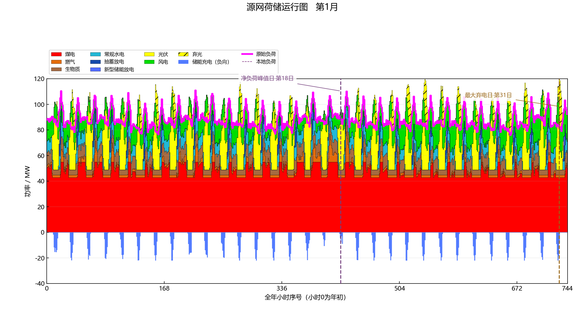
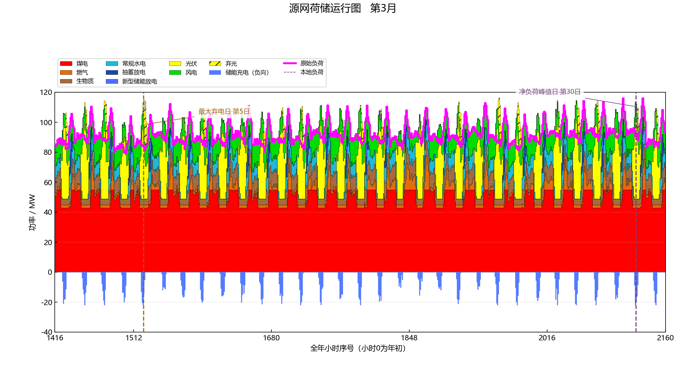
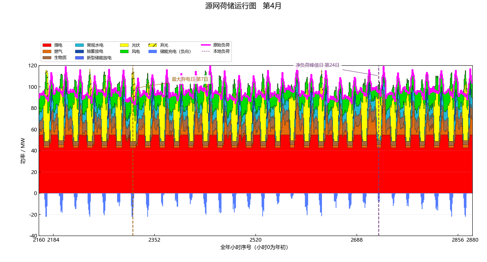
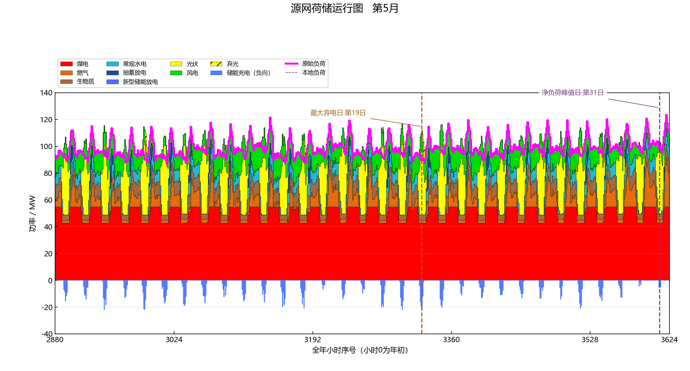
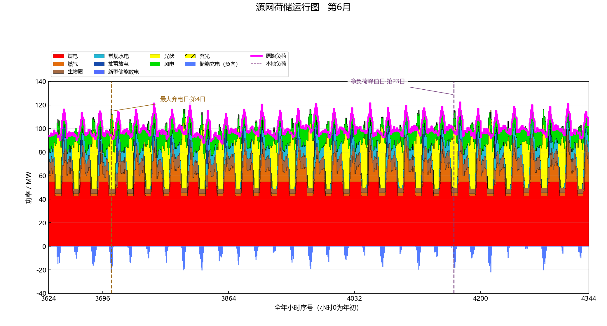
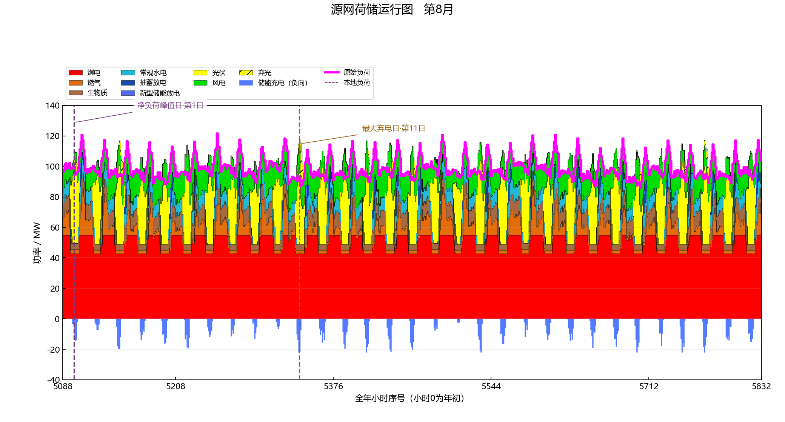
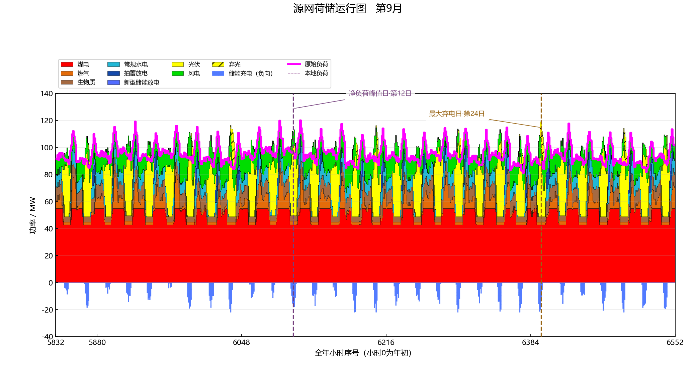
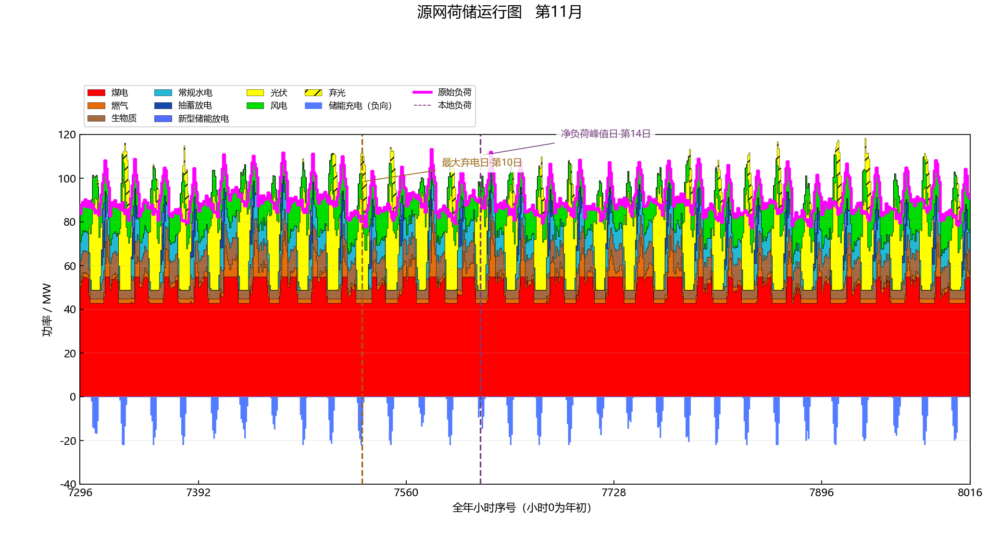
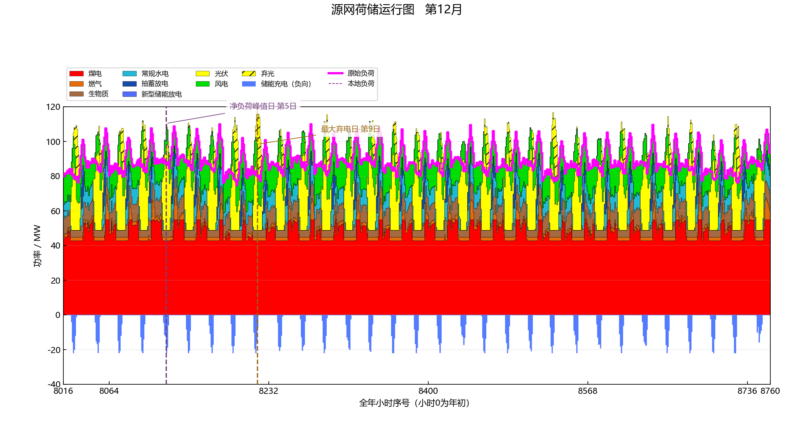

# 三年度合成案例末年逐月运行图 / Full-horizon final-year monthly gallery

本页展示完全合成的三年度GA/动态规划案例在最终规划年2028的12张自然月图。每张由应用的同一交互绘图函数从**选中状态2**的8760小时原值导出，源表在[最终年工作簿](../examples/results/v0.2.4/full_horizon_final_year.xlsx)。这不是任何地区的实际出力。All inputs use fixed synthetic seeds and an illustrative cost table; the final-year load is 1.08 times the shared synthetic base curve.

煤、气、常规水电、生物质、抽蓄、电池、风和光均有实际年度发电或储能放电。正常风光为纯色，弃风光为同色斜线，储能充电绘于零线下方，洋红线为原始负荷。The monthly PNGs keep every hourly point and use the application's single stacked chart with a prominent demand trace.

独立回算的最终年缺供与在线备用不足均为0。因此各月不标虚构的“最大缺口日”；改标净负荷峰值日，并标真实最大弃电日。Event values, inclusive month starts and exclusive ends are archived in [monthly_events.csv](../examples/results/v0.2.4/full_horizon_monthly_events.csv).

| 月 / Month | 全年小时 `[start,end)` | 净负荷峰值日 / Peak day | 最大弃电日 / Curtailment day |
|---:|---:|---:|---:|
| 1 | `[0,744)` | 18 | 31 |
| 2 | `[744,1416)` | 8 | 4 |
| 3 | `[1416,2160)` | 30 | 5 |
| 4 | `[2160,2880)` | 24 | 7 |
| 5 | `[2880,3624)` | 31 | 19 |
| 6 | `[3624,4344)` | 23 | 4 |
| 7 | `[4344,5088)` | 17 | 3 |
| 8 | `[5088,5832)` | 1 | 11 |
| 9 | `[5832,6552)` | 12 | 24 |
| 10 | `[6552,7296)` | 12 | 5 |
| 11 | `[7296,8016)` | 14 | 10 |
| 12 | `[8016,8760)` | 5 | 9 |

| 一月 / January | 二月 / February |
|---|---|
|  |  |

| 三月 / March | 四月 / April |
|---|---|
|  |  |

| 五月 / May | 六月 / June |
|---|---|
|  |  |

| 七月 / July | 八月 / August |
|---|---|
|  |  |

| 九月 / September | 十月 / October |
|---|---|
|  |  |

| 十一月 / November | 十二月 / December |
|---|---|
|  |  |

每张月图采用应用查看器的Matplotlib导出，属于交互视图的图片存档；三年度阶段费用的独立静态科研图由Origin原生工程生成，见[案例正文](CASE_STUDY.md)。The renderer is disclosed per figure type; none of these images encodes project-derived data.
