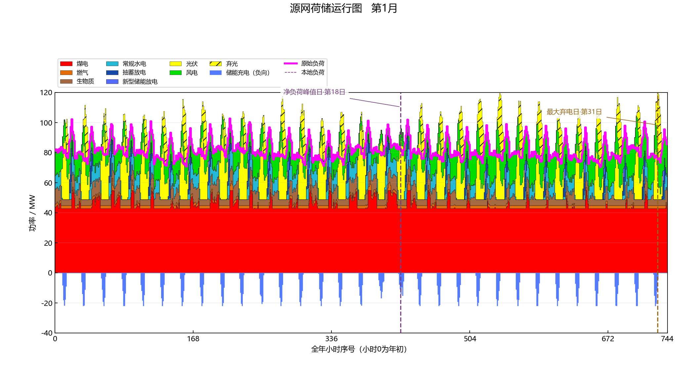
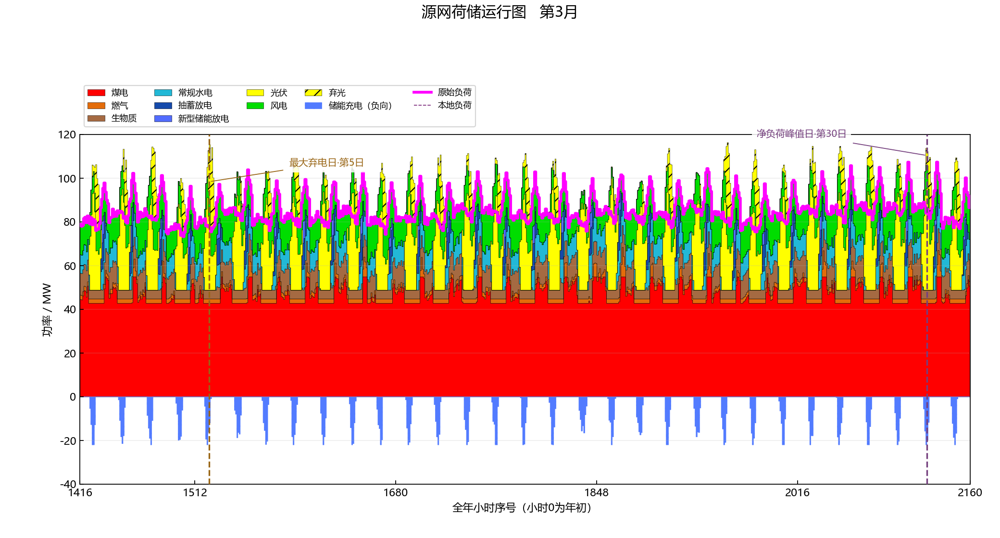
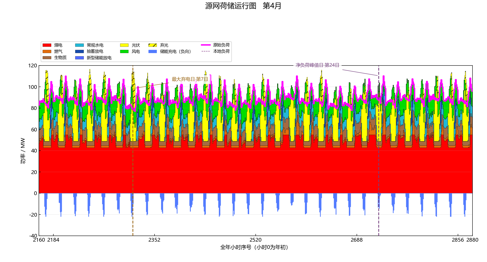
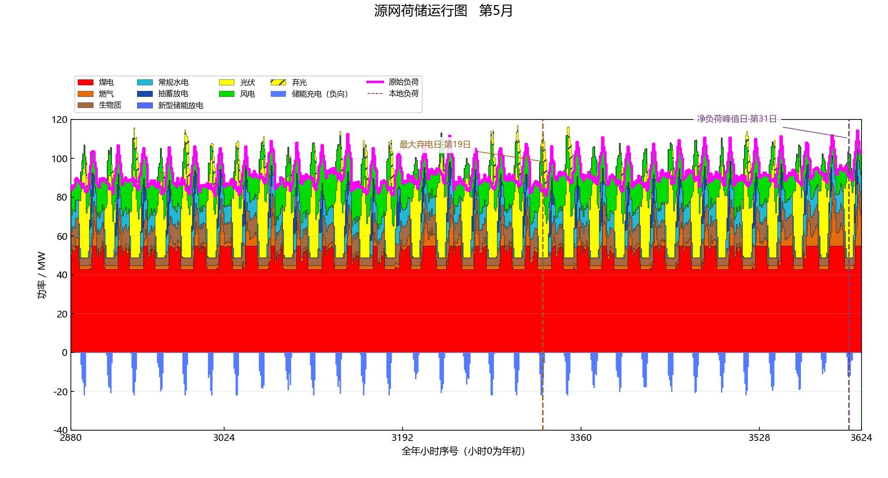
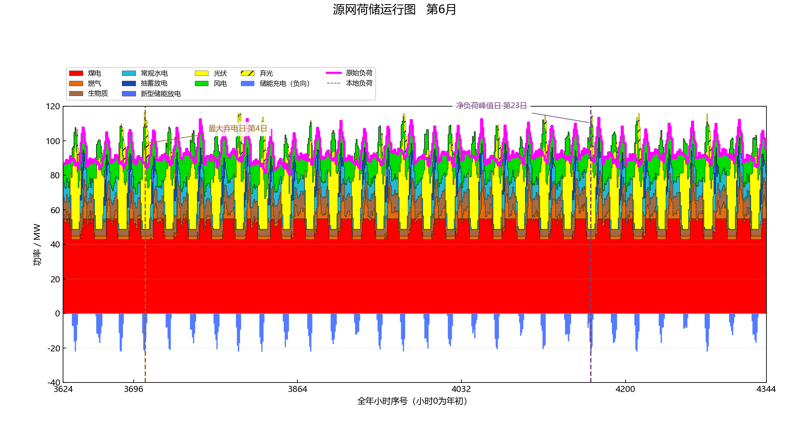
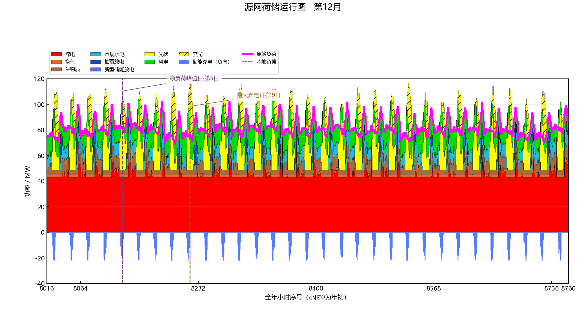

# 12 张自然月运行图 / Twelve monthly operation views

以下图全部来自固定随机种子的公开合成八类电源案例，由 GRIDMIND 单张堆叠图查看器按自然月导出；每张保留当月全部逐小时值。风、光正常发电为纯色；弃风、弃光为对应颜色斜线；储能充电位于零线下方，洋红线表示总需求。All twelve PNGs use the same hourly renderer as the application and keep every hour of their month.

该方案全年缺供与在线备用不足均为零，因此**没有“最大缺口日”**。每月改标真实的净负荷峰值日，并同时标注最大弃电日；若将来算例确实存在缺口，代码会优先标缺供日，其次标备用不足日。No zero-valued shortage is mislabeled as a shortage event.

| 月 / Month | 小时范围 / Hours `[start,end)` | 净负荷峰值日 / Net-load peak day | 最大弃电日 / Max curtailment day |
|---:|---:|---:|---:|
| 1 | `[0,744)` | 18 | 31 |
| 2 | `[744,1416)` | 8 | 4 |
| 3 | `[1416,2160)` | 30 | 5 |
| 4 | `[2160,2880)` | 24 | 7 |
| 5 | `[2880,3624)` | 31 | 19 |
| 6 | `[3624,4344)` | 23 | 4 |
| 7 | `[4344,5088)` | 17 | 3 |
| 8 | `[5088,5832)` | 1 | 11 |
| 9 | `[5832,6552)` | 12 | 24 |
| 10 | `[6552,7296)` | 12 | 3 |
| 11 | `[7296,8016)` | 14 | 10 |
| 12 | `[8016,8760)` | 5 | 9 |

| January / 一月 | February / 二月 |
|---|---|
|  |  |

| March / 三月 | April / 四月 |
|---|---|
|  |  |

| May / 五月 | June / 六月 |
|---|---|
|  |  |

| July / 七月 | August / 八月 |
|---|---|
|  |  |

| September / 九月 | October / 十月 |
|---|---|
|  |  |

| November / 十一月 | December / 十二月 |
|---|---|
|  |  |

事件原始值见 [monthly_events.csv](../examples/results/v0.2.0/monthly_events.csv)，包含月边界、日序号、起始全年小时、数值及单位。The event table lets readers verify every marker against the hourly workbook.
