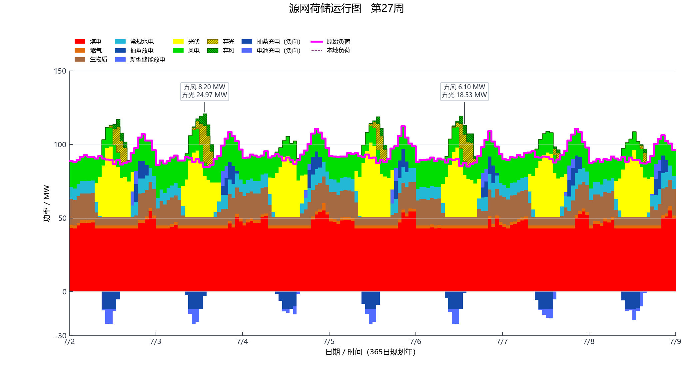

# 日、周运行图

两张图片均来自 `examples/results/v0.2.14` 的同次单年度算例，实际绘图后端为已有 Python/Matplotlib 查看器。没有重新运行模拟，也没有更改逐时值。核对数值使用[年度工作簿](../examples/results/v0.2.14/ga_annual_summary.xlsx)。

正向实色为实际发电或放电；斜线为弃电，不能加进实际供电；零线下为充电。洋红线为总需求。当前展示保留日、周两种可读尺度，全年数据在工作簿中保留。

## 第 182 日

## 第 27 周

图片沿用存档导出物。图源数值、绘图脚本和算例版本一并列于[算例说明](CASE_STUDY.md)与[`viewer.py`](../power_ga/result_output/viewer.py)。
